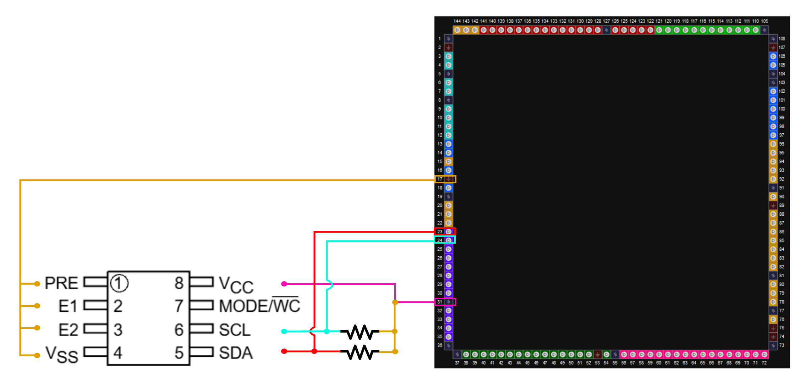

# Documentación EEPROM – FPGBC Game Boy

- **FPGA:** Gowin GW2AR-18, encapsulado EQ144 (`GW2AR-LV18EQ144PC`)
- **EEPROM:** STMicroelectronics ST24C04 (Interfaz I²C)

## Documentos de referencia

| Documento | Descripción | Enlace |
|---|---|---|
| Datasheet ST24C04 | Pinout, protocolo I²C, temporización, protección de escritura | [PDF](Docs/ST24C04.pdf) |
| Gowin FPGA Products Programming and Configuration Guide | Programación y configuración de la FPGA (modos, bitstream, pines de configuración) | [PDF](Docs/GowinFPGAProducts.pdf) |
| GW2AR series of FPGA Products Package & Pinout User Guide | Pinout del encapsulado EQ144, bancos de I/O, alimentación | [PDF](Docs/PinoutUserGuide.pdf) |

### Pines de la FPGA involucrados

| Pin FPGA (N.º) | Nombre del pin | Función | Función de configuración | Conectado a |
|:---:|---|---|---|---|
| 17 | GND | Tierra | Ninguna | EEPROM pines 1 (PRE), 2 (E1), 3 (E2) y 4 (VSS) |
| 23 | IOL32A | I/O | Ninguna | EEPROM **SDA** o **SCL** (por verificar, ver nota) |
| 24 | IOL32B | I/O | Ninguna | EEPROM **SCL** o **SDA** (por verificar, ver nota) |
| 31 | VCCX / VCCIO4 / VCCIO | Alimentación | Ninguna | EEPROM pin 8 (VCC) y pull-ups de SDA/SCL |

> En el esquemático el pin 23 va a SDA y el pin 24 a SCL. En la versión de la tabla del github estaban al revés.

### Pines del ST24C04 (encapsulado de 8 pines)

| Pin EEPROM | Nombre | Conexión | Notas |
|:---:|---|---|---|
| 1 | PRE (Protect Enable) | GND (pin 17 FPGA) | A tierra: sin protección de escritura por este pin (confirmar en datasheet) |
| 2 | E1 (Chip Enable) | GND (pin 17 FPGA) | Bit de dirección I²C = 0 |
| 3 | E2 (Chip Enable) | GND (pin 17 FPGA) | Bit de dirección I²C = 0 |
| 4 | VSS | GND (pin 17 FPGA) | Tierra del integrado |
| 5 | SDA | Pin 23 FPGA (por verificar) | Datos I²C, con resistencia pull-up a VCC |
| 6 | SCL | Pin 24 FPGA (por verificar) | Reloj I²C, con resistencia pull-up a VCC |
| 7 | MODE/WC | **Sin conexión dibujada, por medir** | Selección de modo de escritura / control de escritura |
| 8 | VCC | Pin 31 FPGA (VCCIO4) | Alimentación |

---

## Esquemático de conexiones

*Figura 1. Conexiones del ST24C04 hacia la FPGA GW2AR-18.*

- Pines 1 a 4 del ST24C04 unidos entre sí y conectados al pin 17 de la FPGA (GND).
- Pin 8 (VCC) conectado al pin 31 de la FPGA (alimentación del banco de I/O).
- SDA y SCL con una resistencia cada una hacia VCC (pull-ups, necesarios en I²C porque las líneas son open-drain).

