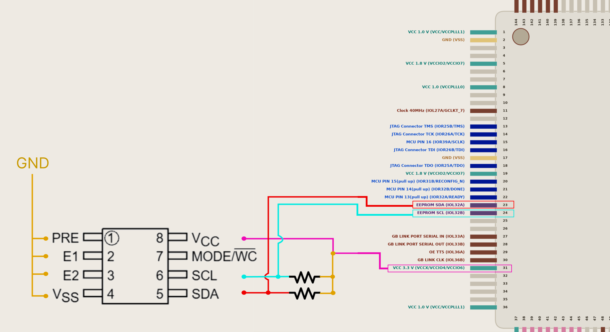

# EEPROM 

## 2. Documentos de referencia
 
| Documento | Descripción | Enlace |
|---|---|---|
| Datasheet ST24C04 | Pinout, memoria, protocolo I²C, temporización y protección de escritura | [PDF](Docs/ST24C04.pdf) |
| Gowin FPGA Products Programming and Configuration Guide | Programación y configuración (SRAM/Flash, bitstream, JTAG) | [PDF](Docs/GowinFPGAProducts.pdf) |
| GW2AR Package & Pinout User Guide | Pinout EQ144, bancos de I/O, alimentación | [PDF](Docs/PinoutUserGuide.pdf) |
 
---
 
## 3. Conexiones físicas
 
### 3.1 Pines de la FPGA (`GW2AR-LV18EQ144`)
 
| Pin FPGA | Nombre | Función | I/O | Conectado a |
|:---:|---|---|---|---|
| 17 | GND | Tierra | — | EEPROM pines 1, 2, 3 y 4 |
| 23 | IOL32A | I/O bidireccional (open-drain) | `LVCMOS33` | EEPROM pin 5 (`SDA`) |
| 24 | IOL32B | Salida de reloj maestro | `LVCMOS33` | EEPROM pin 6 (`SCL`) |
| 31 | VCCIO4 | Alimentación banco 4 (3.3 V) | — | EEPROM pin 8 (`VCC`) y pull-ups |
| 28 | IOR36A | UART TX (diagnóstico) | `LVCMOS33` | FT232RL `RXD`, 57600 baudios |
 
 
### 3.2 Pines del ST24C04
 
| Pin | Nombre | Conexión | Función |
|:---:|---|---|---|
| 1 | `PRE` | GND | Sin protección de escritura por hardware |
| 2 | `E1` | GND | Bit del código de dispositivo = 0 |
| 3 | `E2` | GND | Bit del código de dispositivo = 0 |
| 4 | `VSS` | GND | Tierra |
| 5 | `SDA` | FPGA pin 23 | Datos I²C (open-drain + pull-up) |
| 6 | `SCL` | FPGA pin 24 | Reloj I²C (+ pull-up) |
| 7 | `MODE` | Sin conexión (internamente se lee como `VIH`) | `VIH` = Multibyte Write (4 B), `VIL` = Page Write (8 B). El `WC` solo existe en las versiones W04 |
| 8 | `VCC` | 3.3 V | Alimentación (3–5.5 V en ST24C04; 2.5–5.5 V en ST25C04) |
 
 

 
*Figura 1. Conexiones del ST24C04 hacia la FPGA GW2AR-18.*
 
---
 
## 4. Fundamentos del ST24C04
 
### 4.1 Memoria y direccionamiento
 
- 4 Kbit = **512 bytes**, divididos en dos bloques de 256 bytes (la dirección de 8 bits no alcanza para 512).
- El bloque se elige con el bit `A8` dentro del byte de control (*Device Select*): `1010 E2 E1 A8 R/W`.
| Bloque | Rango | Escritura | Lectura |
|:---:|---|:---:|:---:|
| 0 | `0x000–0x0FF` | `0xA0` | `0xA1` |
| 1 | `0x100–0x1FF` | `0xA2` | `0xA3` |
 
### 4.2 Protección de escritura
 
- El pin 7 es **siempre `MODE`** en el ST24C04 (versión C). `WC` solo existe en ST24W04/ST25W04.
- La protección de escritura es por *software + PRE*: solo protege parte del bloque 1 (`0x100–0x1FF`), entre una frontera definida en la dirección `0x1FF` (*Block Address Pointer*, bit b2 = 0) y el final de la memoria, y solo cuando `PRE = 1`.
- Con `PRE = 0` (nuestro caso) no hay protección. **Evita escribir en `0x1FF`** salvo que sepas lo que haces: es el registro de protección.
- Los chips nuevos vienen con todo en `0xFF`: si lees `0xFF`, la escritura no ocurrió.
### 4.3 Temporizaciones (VCC = 3.3 V, reloj FPGA 27 MHz)
 
| Parámetro | Símbolo | Mín. | Máx. | Implementado |
|---|---|---|---|---|
| Frecuencia SCL | $f_{SCL}$ | — | 100 kHz (este chip no soporta 400 kHz) | 100 kHz (semiperiodo 5 µs = 135 ciclos) |
| Mantenimiento de START | $t_{HD:STA}$ | 4.0 µs | — | 5.0 µs |
| Establecimiento de STOP | $t_{SU:STO}$ | 4.7 µs | — | 5.0 µs |
| Bus libre STOP→START | $t_{BUF}$ | 4.7 µs | — | ≥ 5.0 µs |
| **Ciclo de escritura interna** | $t_{WR}$ | — | **10 ms** | 10 ms (**sin margen**; usar ≥ 15 ms o ACK polling) |
 
> **Importante ($t_{WR}$):** tras el `STOP` de una escritura, la EEPROM queda ocupada hasta 10 ms y **no responde ACK**. Hay que esperar o hacer *ACK polling* (enviar `0xA0` hasta recibir ACK) antes de la siguiente operación.
 
### 4.4 Tramas I²C
 
**Byte Write**
 
```text
[START] [0xA0] [ACK] [Addr] [ACK] [Data] [ACK] [STOP]  -> esperar t_WR
```
 
**Random Read** (dummy write + repeated START):
 
```text
[START] [0xA0] [ACK] [Addr] [ACK] [Re-START] [0xA1] [ACK] [Data leído] [NACK maestro] [STOP]
```
 
Reglas clave del protocolo:
 
- SDA solo cambia mientras SCL está en **bajo** (excepto START/STOP).
- El receptor **muestrea** SDA con SCL en **alto**.
- El 9.º pulso de cada byte es el ACK: el receptor baja SDA (`0` = ACK, `1` = NACK).
- En lectura, el maestro responde **NACK** al último byte para indicar "no quiero más".
---
 
## 5. Arquitectura del módulo de prueba (`top_eeprom_test.v`)
 
Código [`src/top_eeprom_test.v`](Códigos/top_eeprom_test.v).
 
### 5.1 Interfaz
 
| Puerto | Dir. | Pin FPGA | Descripción |
|---|:---:|:---:|---|
| `clk` | in | — | Reloj principal de 27 MHz |
| `resetn` | in | — | Reset asíncrono activo en bajo |
| `sda` | inout | 23 | Datos I²C (open-drain) |
| `scl` | out | 24 | Reloj I²C generado por el maestro |
| `TXD` | out | 28 | UART de diagnóstico, 57600 8N1 |
 
### 5.2 Parámetros de temporización
 
| Constante | Valor | Significado |
|---|---|---|
| `DELAY_10MS` | 270 000 ciclos | Arranque y espera de $t_{WR}$ |
| `I2C_HALF_BIT` | 135 ciclos (5 µs) | Duración de **cada sub-paso** del bus |
| `UART_BIT_CNT` | 468 ciclos | Un bit UART a 57600 baudios |
 
### 5.3 Estructura: dos niveles de máquina de estados
 
1. **Sub-máquina de byte** (activa con `byte_active = 1`): envía o recibe 8 bits más el bit de ACK/NACK. Cada bit pasa por 4 sub-pasos de 5 µs:
```text
sub_step 0: SCL=0, colocar el bit en SDA (o soltar SDA si se lee)
sub_step 1: SCL=1
sub_step 2: muestrear SDA (dato leído, o ACK de la EEPROM)
sub_step 3: SCL=0 y avanzar al siguiente bit
```
 
2. **FSM de alto nivel:** genera START, STOP y Repeated START, lanza la sub-máquina de byte, espera y reporta por UART.
| Fase | Estados | Qué hace |
|---|---|---|
| Arranque | `ST_BOOT_DELAY` | Espera 10 ms |
| Escritura | `ST_WR_START` → `ST_WR_CTRL` (0xA0) → `ST_WR_ADDR` (0x00) → `ST_WR_DATA` (0x47) → `ST_WR_STOP` | *Byte Write* |
| Grabación | `ST_EEPROM_WAIT` | Espera de $t_{WR}$ |
| Lectura | `ST_RD_START1` → `ST_RD_CTRL_W` → `ST_RD_ADDR` → `ST_RD_RESTART` → `ST_RD_CTRL_R` (0xA1) → `ST_RD_READ_BYTE` (NACK) → `ST_RD_STOP` | *Random Read* |
| Reporte | `ST_UART_PREP` → `ST_UART_SEND` → `ST_DONE` | Envía `NO ACK` o `RD: X` |
 
### 5.4 SDA open-drain
 
El maestro nunca fuerza un `1`: o baja la línea o la suelta, y la pull-up la sube.
 
```verilog
assign sda = sda_out ? 1'bz : 1'b0;   // sda_out=1 -> suelta; 0 -> conduce a GND
```
 
### 5.5 Observaciones sobre el código (a corregir o tener presentes)
 
- **Frecuencia real de SCL ≈ 50 kHz, no 100 kHz:** cada bit usa 4 sub-pasos de 5 µs (periodo de 20 µs). Está dentro de especificación (máximo 100 kHz), solo hay que documentarlo así.
- **$t_{WR}$:** el comentario del código dice "≤ 5 ms", pero el datasheet indica 10 ms máx., y la espera es de exactamente 10 ms. Subir a 15–20 ms o usar *ACK polling*.
- **Salida UART:** en el código pegado aparece `assign tTXD = txd_reg;`, pero el puerto se llama `TXD`. Debe ser `assign TXD = txd_reg;` (verificar que el archivo real lo tenga bien).
- **Un solo `ack_error` para todo:** no distingue en qué byte falló el ACK. Conviene separar un flag por etapa.
- **La UART imprime el byte crudo:** si se lee `0xFF` (memoria sin escribir), el terminal muestra un carácter ilegible. Imprimir el valor en **hexadecimal** hace obvio qué se leyó.

## 6. Avances
 
| Etapa | Descripción | Herramientas | Estado |
|---|---|---|---|
| 1. Mapeo de pines | SDA (23), SCL (24), TXD (28) en `test.cst` | Gowin Pinout Guide | Completado |
| 2. Síntesis y P&R | `GW2AR-LV18EQ144PC8/I7` | Yosys + nextpnr-himbaechel + gowin_pack |  0 errores |
| 3. Carga en FPGA | Programación SRAM por JTAG | openFPGALoader | 100 % |
| 4. Detección I²C | `0xA0` + verificación de ACK | Bus I²C + UART (minicom) | `ACK OK` |
| 5. Escritura / lectura | Byte Write → espera → Random Read | FSM I²C + UART | En depuración |
| 6. Integración SoC | Periférico mapeado en memoria | Verilog / bus del SoC | Pendiente |
 
---
